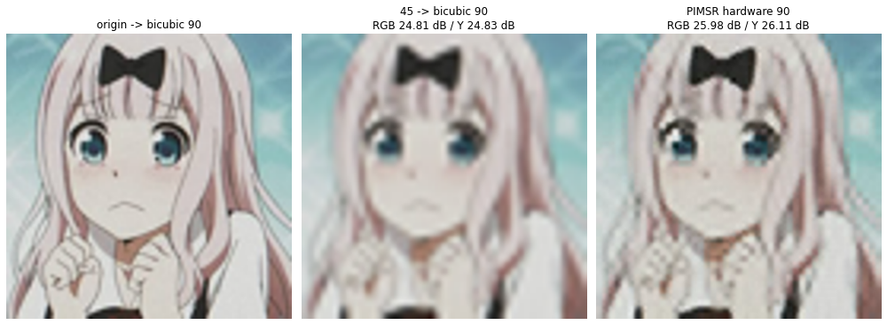
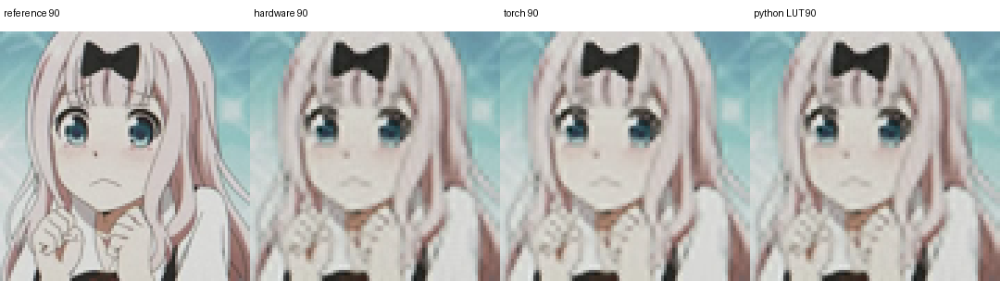
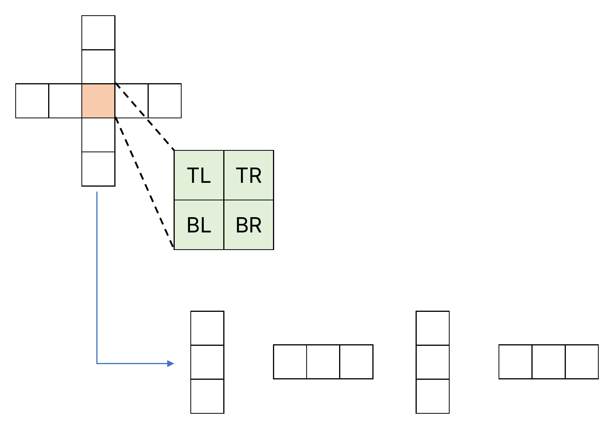
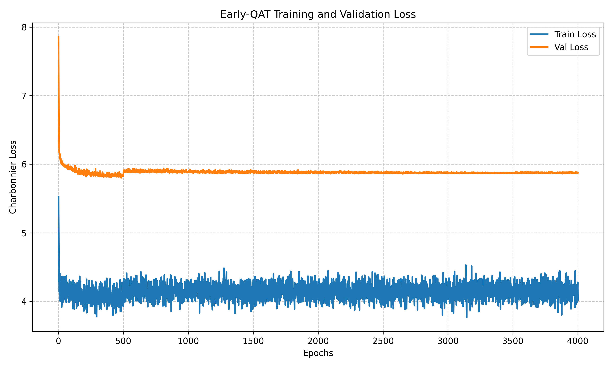
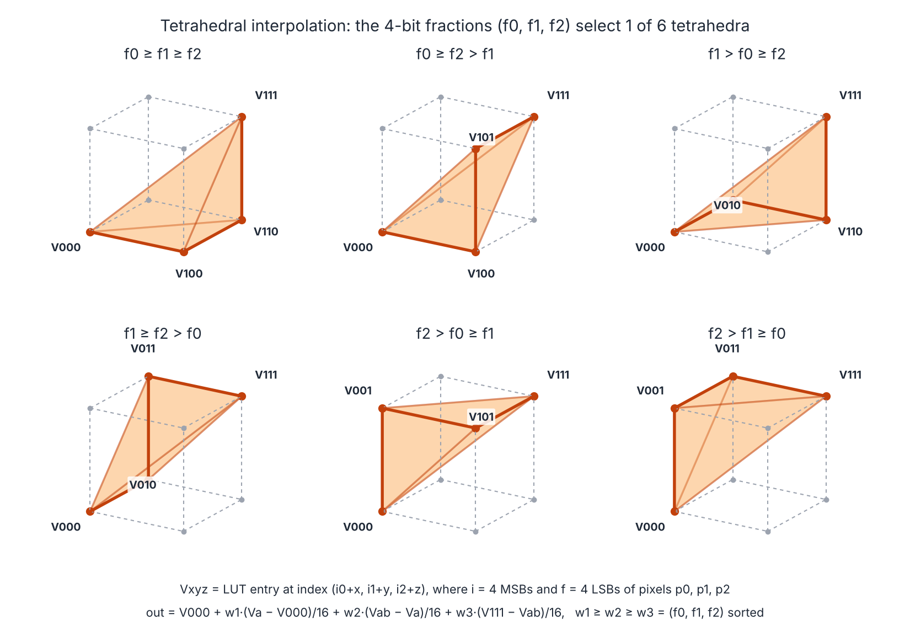
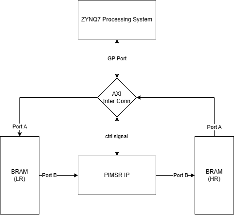
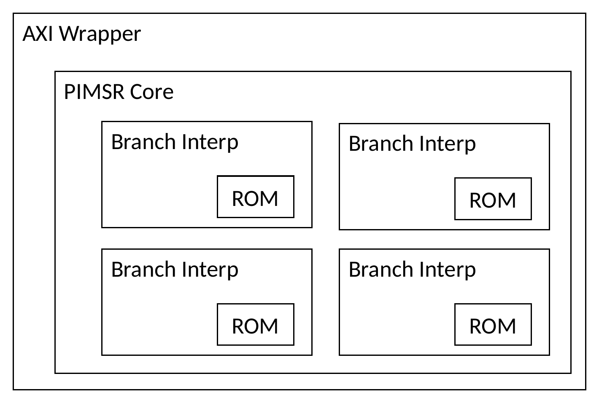
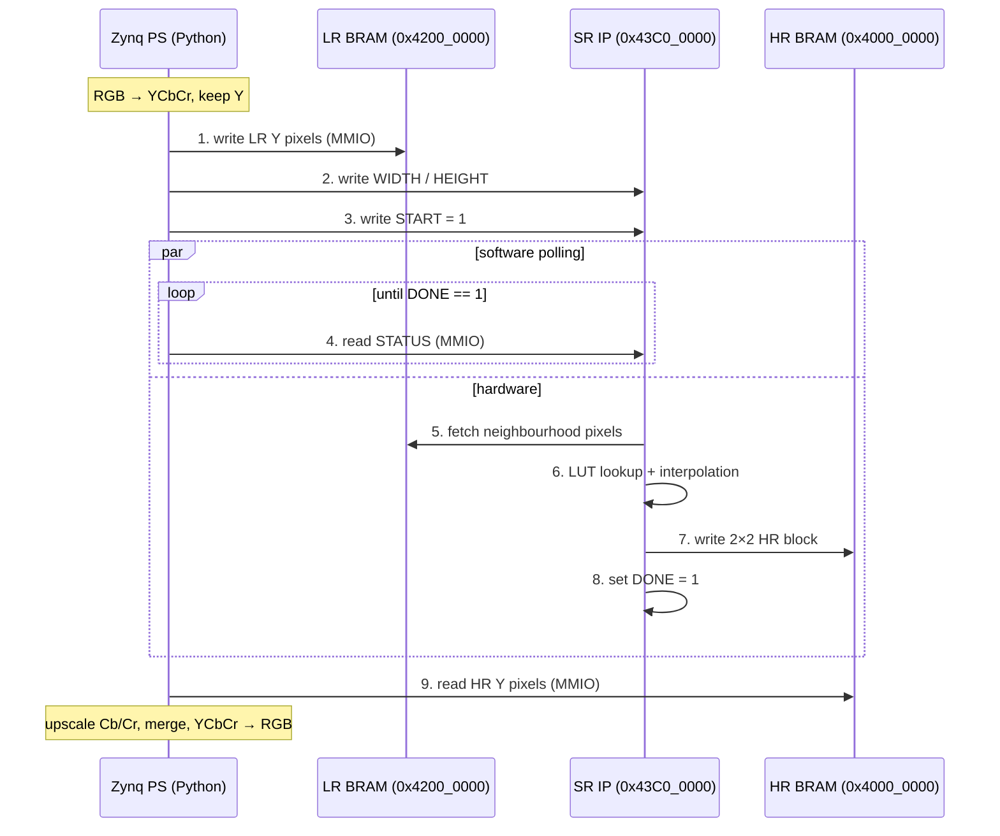

# Super-Resolution on PYNQ-Z2 Using LUTs

**LUT-Super-Resolution-on-PYNQ-Z2** — an end-to-end ×2 image super-resolution system taken from a PyTorch model to a working FPGA accelerator on the PYNQ-Z2 (Zynq-7020). The neural network is trained with quantization-aware training, collapsed into four small lookup tables, and executed in custom Verilog as an AXI IP, with no neural-network layers to compute at runtime.

> **Note:** This is an **unofficial, independent** project inspired by the PIMSR paper by J. Guan et al. ([TCAS-II 2025](https://doi.org/10.1109/TCSII.2025.3545466)). It is not affiliated with or endorsed by the original authors. It does **not** reproduce the paper's architecture or results, and its performance does not reflect the original work. File and module names keep a `pimsr_` prefix for that reason. See [References](#references).

---

## Highlights

- **Full-stack flow:** model design → QAT training → LUT extraction → RTL → Vivado block design → bitstream → Python driver on the board.
- **4096× smaller LUTs:** a 256 MiB exact LUT was reduced to **64 KiB** of on-chip ROM by sampling 4 MSBs per pixel and restoring the rest with tetrahedral interpolation in hardware.
- **Hardware-exact training:** the network quantizes each branch to signed int8 and sums/clamps exactly like the RTL, so the trained model, the Python LUT simulator, and the FPGA share one numeric contract.
- **Small footprint, timing met:** 3.4 % LUTs, 1.8 % FFs, 11 % BRAM, 16 % DSPs of the Zynq-7020, with +2.1 ns slack at 100 MHz.
- **Layered verification:** bit-accurate Python golden model → randomized pixel-core testbench → image-level testbench → on-board check against the same golden data.
- **Runs on real hardware, bit-exact:** 45 × 45 → 90 × 90 on the PYNQ-Z2, output identical to the Python LUT simulator and **+1.28 dB Y-PSNR over bicubic** on the test image.

---

## Results

### On-board (PYNQ-Z2)

`pynq/PS/pimsr_compare_origin_45_90.ipynb`; reference = original image bicubic-resized to 90 × 90.

<p align="center">
  
</p>

| Method (45 → 90) | RGB PSNR | Y PSNR |
|---|---:|---:|
| Bicubic | 24.81 dB | 24.83 dB |
| PyTorch model (software) | 26.29 dB | 26.41 dB |
| Python sampled-LUT simulator (software) | 25.98 dB | 26.11 dB |
| **This work (FPGA)** | **25.98 dB** | **26.11 dB** |

<p align="center">
  
  <br><em>Left to right: reference, FPGA, PyTorch model, Python sampled-LUT simulator.</em>
</p>

- The FPGA output is **identical** to the Python sampled-LUT simulator, confirming the RTL is bit-exact.
- The 0.3 dB gap to the PyTorch model is the price of turning the network into a 64 KiB sampled LUT.
- This is a single-image sanity check of the complete PS + PL path, not a standard benchmark.
- Test image: a screenshot from the anime *Kaguya-sama: Love Is War* (© Aka Akasaka / Shueisha, Kaguya-sama Production Committee), used here only as a non-commercial research demonstration at 90 × 90 pixels. All rights belong to the copyright holders; it will be removed on request.

### FPGA resources (`pimsr_image_core`, synthesis, 100 MHz)

| Resource | Used | Available | Util. |
|---|---:|---:|---:|
| Slice LUTs | 1,781 | 53,200 | 3.35 % |
| Flip-flops | 1,960 | 106,400 | 1.84 % |
| RAMB36 | 16 | 140 | 11.43 % |
| DSP48E1 | 36 | 220 | 16.36 % |
| Worst negative slack | +2.103 ns | | met |

### LUT size

| Version | Entries per branch | Storage (4 branches) | Where it lives |
|---|---:|---:|---|
| Exact 8-bit LUT | 16,777,216 | 256 MiB | Golden model only |
| **4-bit sampled + interpolation** | **4,096** | **64 KiB** | **On-chip BRAM ROM** |

---

## How it works

```
 PyTorch (QAT + SWA)  ──►  Exact 8-bit LUTs  ──►  4-bit sampled LUTs  ──►  Verilog AXI IP  ──►  PYNQ-Z2
   model/torch             model/LUT              .mem / .coe              pynq/PL             pynq/PS
```

### 1. A network built to become a LUT

Each output depends on four **directional branches**, and each branch sees exactly **three pixels**, so it can be enumerated as a 3-D table:

| Branch | Inputs for LR pixel `(i, j)` |
|---|---|
| `left` | `x[i, j-2], x[i, j-1], x[i, j]` |
| `right` | `x[i, j], x[i, j+1], x[i, j+2]` |
| `top` | `x[i-2, j], x[i-1, j], x[i, j]` |
| `bot` | `x[i, j], x[i+1, j], x[i+2, j]` |

<p align="center">
  
  <br><em>The centre LR pixel (orange) and its cross-shaped neighbourhood produce one 2×2 HR block (TL/TR/BL/BR). The neighbourhood is split into four 3-pixel windows, one per branch LUT.</em>
</p>

- Each branch: `Conv(1→64)` → 7 × (`1×1 Conv 128` + ReLU) → `1×1 Conv → 4`, giving the 4 pixels of a 2×2 HR block.
- A nearest-neighbour base is split evenly across the branches (`base / 4`), so each LUT entry already carries its share.
- QAT fake-quantizes every branch to int8 with a straight-through estimator; outputs are summed, clamped to `0..255`, and placed with `PixelShuffle(2)`.
- Training: Charbonnier loss on Y, Adam + cosine schedule, 500 float warm-up epochs → QAT → SWA for the last 500 of 4000 epochs.



### 2. Making the LUT fit on chip

The exact LUT needs 256 MiB, but the Zynq-7020 has about 630 KB of BRAM. Each input pixel is therefore split into a 4-bit index and a 4-bit fraction:

- The **index** `{p0[7:4], p1[7:4], p2[7:4]}` addresses a 4096-entry table (32-bit word = 4 × signed int8).
- The **fractions** are sorted to choose one of six tetrahedra in the sampling cube, and the output is a weighted sum of four cube vertices (tetrahedral interpolation, as in SR-LUT).

<p align="center">
  
  <br><em>Each branch reads the 8 corners of the sampling cube, and the ordering of the fractions picks one tetrahedron. The output walks from V000 through two intermediate corners (Va, Vab) to V111, weighting each step by w1, w2, w3. The six cases match <code>pimsr_branch_interp_seq.v</code>.</em>
</p>

- `model/LUT/eval_lut_compression.py` also explores per-branch input bit-widths and reduced output precision.

### 3. Hardware architecture

<p align="center">
  
  &nbsp;&nbsp;&nbsp;
  
  <br><em>Left: system block design. The PS reaches both BRAMs (port A) and the IP's control registers through the AXI interconnect; the IP reads LR and writes HR through port B. Right: inside the IP, four branch interpolators each own a LUT ROM.</em>
</p>

```
pimsr_axi_ip (AXI4-Lite slave + 2 BRAM ports)
└── pimsr_image_core          raster-scan FSM: fetch 12 LR samples, write one 2×2 HR block
    └── pimsr_lut_pixel_core  4 branches in parallel → signed sum → clamp to u8
        └── pimsr_branch_interp_seq ×4   8 ROM reads + tetrahedral interpolation
            └── pimsr_sampled_lut_rom    4096 × 32-bit ROM ($readmemh)
```

The ARM core writes the LR image into an AXI BRAM, starts the IP through a control register, and reads the HR image from a second BRAM. The datapath is sequential: correctness and area came first, throughput is the next step (see [Limitations](#limitations-and-next-steps)).



| Block | Base address | Size |
|---|---|---|
| Control registers | `0x43C0_0000` | 64 KiB |
| LR BRAM (8-bit pixels, 4 per word, little-endian) | `0x4200_0000` | 8 KiB |
| HR BRAM | `0x4000_0000` | 8 KiB |

| Offset | Register | Description |
|---|---|---|
| `0x00` | CONTROL / STATUS | Write bit 0 = 1 to start (also clears done). Read: bit 1 = done, bit 2 = busy. |
| `0x04` | WIDTH | Read-back of `IMG_W` (the core uses the synthesis parameter). |
| `0x08` | HEIGHT | Read-back of `IMG_H` (same note). |

### 4. Verification

| Level | What is checked | Where |
|---|---|---|
| Model ↔ LUT | Exact LUT output vs. PyTorch on random input | `pimsr_lut.py compare` |
| Pixel core | 262 vectors (256 random + 6 edge cases) vs. a bit-accurate Python model of the sampled LUT + interpolation | `tb/gen_pixel_core_vectors.py`, `tb_pimsr_lut_pixel_core_golden.v` |
| Image core | Full 4 × 4 → 8 × 8 image incl. border replication and address generation | `tb/gen_image_core_vectors.py`, `tb_pimsr_image_core.v` |
| Board | Same 4 × 4 golden image through PS + PL | `pynq/PS/pimsr_overlay_smoke.ipynb` |
| Board vs. software | 45 × 45 → 90 × 90 FPGA output identical to the Python sampled-LUT simulator | `pynq/PS/pimsr_compare_origin_45_90.ipynb` |

---

## Limitations and next steps

| Current limitation | Planned improvement |
|---|---|
| Sequential datapath (one LR pixel at a time) | Pipeline the four branch interpolators to approach one HR block per few cycles |
| Image size fixed at synthesis (`IMG_W`, `IMG_H`) | Wire the WIDTH/HEIGHT registers into the core |
| 8 KiB on-chip LR/HR buffers (max 45 × 45 → 90 × 90) | AXI DMA + DDR, or line-buffer streaming |
| Only Y is super-resolved | Chroma uses nearest neighbour; could reuse the Y result for guidance |
| No standard benchmark numbers yet | Report Set5 / Set14 / Urban100 for float, QAT, exact LUT, and sampled LUT |

---

## Repository layout

```
.
├── model/
│   ├── torch/                    # model.py, train.py, eval_all.py, prepare_benchmarks.py, checkpoints/
│   └── LUT/                      # pimsr_lut.py, export_sampled_lut.py, eval_lut_*.py, LUT_README.md
└── pynq/
    ├── PL/
    │   ├── ip_repo/pimsr_axi_ip_1_0/   # packaged AXI IP (HDL + LUT .mem)
    │   └── vivado/                     # Vivado 2022.2 project, rtl/, tb/, lut_sampled_4bit/, reports/, Tcl scripts
    └── PS/                             # pimsr.bit / pimsr.hwh + Jupyter notebooks for the board
```

More detail: [`model/LUT/LUT_README.md`](model/LUT/LUT_README.md) (LUT format and commands) and [`pynq/PL/vivado/README_PIMSR_LUT.md`](pynq/PL/vivado/README_PIMSR_LUT.md) (RTL interface).

---

## Reproduce

**Requirements:** Python 3.10+ (`torch`, `torchvision`, `numpy`, `pillow`, `scikit-image`, `matplotlib`, `tqdm`); Vivado 2022.2 with PYNQ-Z2 board files; a PYNQ-Z2 board. Datasets are not included.

**1. Train and evaluate**

```bash
cd model/torch
python train.py --train-hr datasets/train/Y --train-lr datasets/train/X \
                --val-hr datasets/validate/Y --val-lr datasets/validate/X
python prepare_benchmarks.py && python eval_all.py
```

LR files are named `<name>x2.png`.

**2. Build the LUTs**

```bash
cd model/LUT
python pimsr_lut.py selftest
PYTHONPATH=../torch python pimsr_lut.py export  --checkpoint ../torch/checkpoints/pimsr_final_swa.pth --output-dir lut_out
PYTHONPATH=../torch python pimsr_lut.py compare --checkpoint ../torch/checkpoints/pimsr_final_swa.pth --lut-dir lut_out
python export_sampled_lut.py --full-lut-dir lut_out --output-dir ../../pynq/PL/vivado/lut_sampled_4bit --input-bits 4 --write-coe
```

On PowerShell, set `$env:PYTHONPATH="../torch"` first. The exact LUTs (~256 MiB) are not included in the repository.

**3. Simulate and synthesize**

Open `pynq/PL/vivado/vivado.xpr`, then in the Tcl console:

```tcl
source ./add_pimsr_lut.tcl
source ./add_pimsr_golden_tb.tcl          ;# or add_pimsr_image_tb.tcl
source ./run_pimsr_image_synth_check.tcl
```

Testbenches open their `.mem` files by name; the `add_*.tcl` scripts add those files to the project so xsim copies them into its run directory. Vivado's generated folders (`vivado.runs`, `vivado.cache`, …) are not included; Vivado recreates them from the block design and IP `.xci` files. Run **Generate Block Design** before **Generate Bitstream**.

**4. Run on the board**

Copy `pynq/PS/pimsr.bit`, `pimsr.hwh` and a notebook into one folder on the PYNQ-Z2.

- `pimsr_compare_origin_45_90.ipynb`: put any RGB image named `origin.jpg` next to it.
- `pimsr_overlay_smoke.ipynb`: needs a bitstream built with `IMG_W = IMG_H = 4`; the included `pimsr.bit` is built for 45 × 45.

```python
from pynq import Overlay, MMIO
Overlay("pimsr.bit")
ctrl, lr, hr = MMIO(0x43C00000, 0x10000), MMIO(0x42000000, 0x2000), MMIO(0x40000000, 0x2000)
# write 45×45 Y pixels to lr (4 per word, little-endian)
ctrl.write(0x00, 1)
while not ctrl.read(0x00) & 0b10:
    pass
# read 90×90 Y pixels from hr
```

---

## References

This project builds on the following work:

- **PIMSR**, the four-branch LUT formulation this project follows:
  J. Guan *et al.*, "PIMSR: An Energy-Efficient Processing-in-Memory Accelerator for 60 FPS 4K Super-Resolution," *IEEE Transactions on Circuits and Systems II: Express Briefs*, vol. 72, no. 4, pp. 623–627, Apr. 2025, doi: [10.1109/TCSII.2025.3545466](https://doi.org/10.1109/TCSII.2025.3545466).
- **SR-LUT**, LUT-based super-resolution with sampled LUTs and tetrahedral interpolation:
  Y. Jo and S. J. Kim, "Practical Single-Image Super-Resolution Using Look-Up Table," in *Proc. IEEE/CVF CVPR*, 2021, pp. 691–700.

```bibtex
@article{guan2025pimsr,
  author  = {Guan, J. and others},
  title   = {{PIMSR}: An Energy-Efficient Processing-in-Memory Accelerator for 60 {FPS} {4K} Super-Resolution},
  journal = {IEEE Transactions on Circuits and Systems II: Express Briefs},
  volume  = {72},
  number  = {4},
  pages   = {623--627},
  year    = {2025},
  doi     = {10.1109/TCSII.2025.3545466}
}

@inproceedings{jo2021srlut,
  author    = {Jo, Younghyun and Kim, Seon Joo},
  title     = {Practical Single-Image Super-Resolution Using Look-Up Table},
  booktitle = {Proceedings of the IEEE/CVF Conference on Computer Vision and Pattern Recognition (CVPR)},
  pages     = {691--700},
  year      = {2021}
}
```
